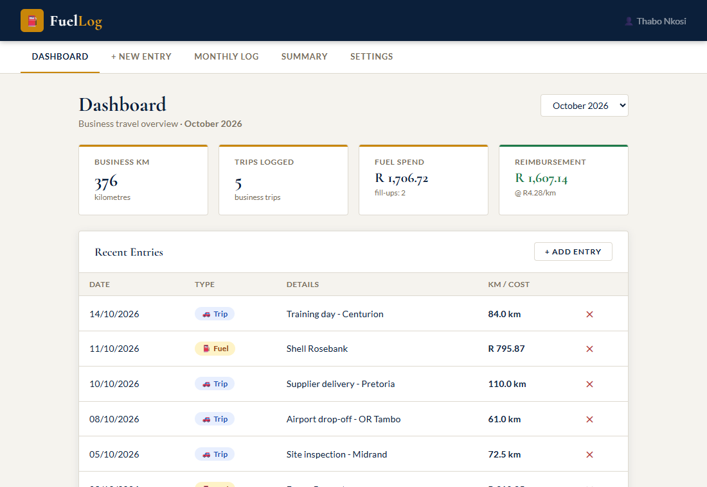
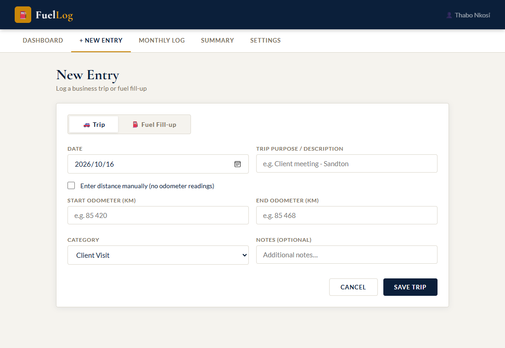
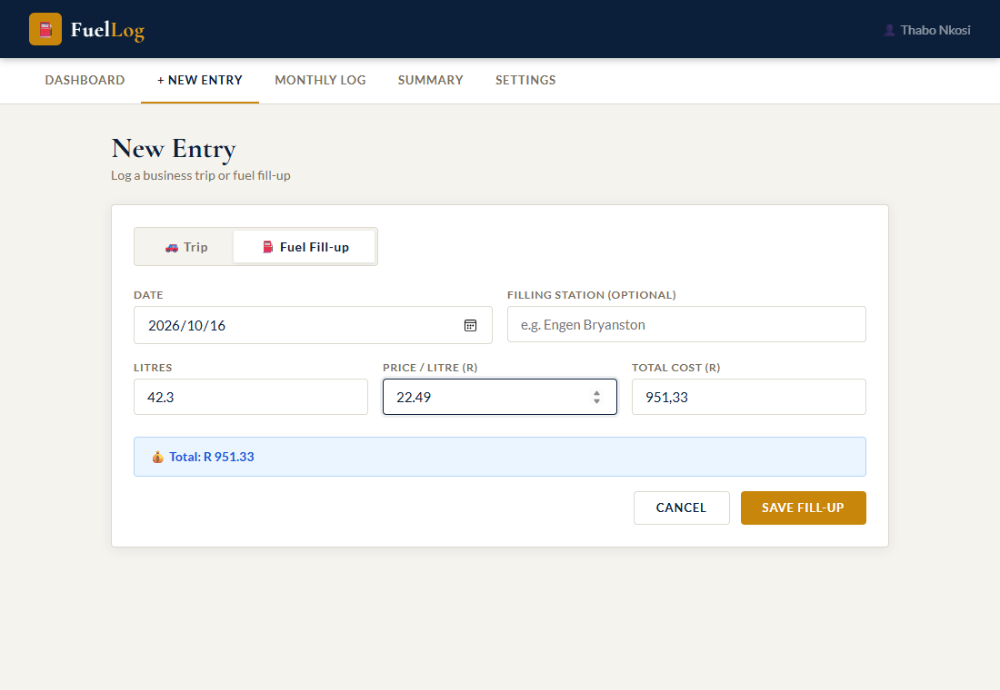
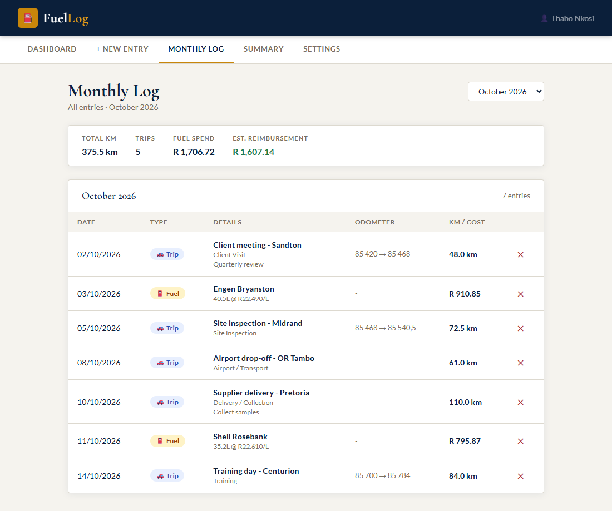
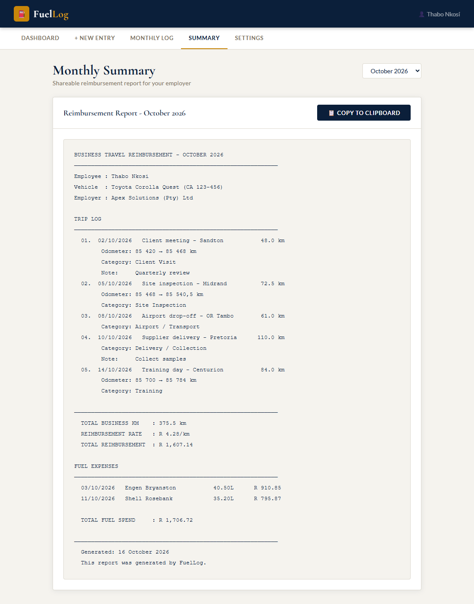
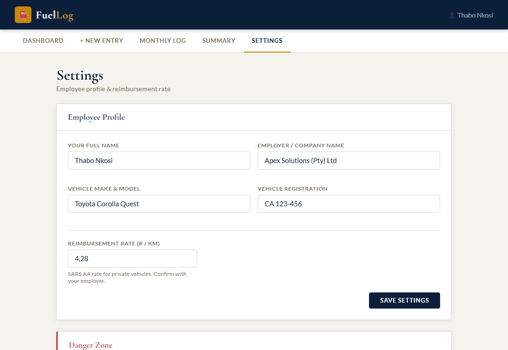
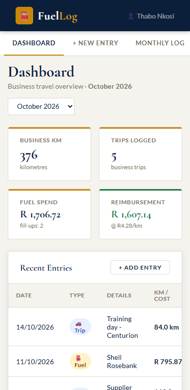

# FuelLog

A lightweight, offline-first web app for logging business trips and fuel fill-ups, and generating a copy-ready monthly reimbursement report for your employer. Built with plain HTML, CSS and JavaScript. No build step, no dependencies, no backend.



## Features

- **Dashboard** with business km, trips logged, fuel spend and estimated reimbursement for any month
- **Trip logging** from start and end odometer readings, or a manually entered distance
- **Fuel fill-ups** with litres, price per litre and total cost (auto-calculated in both directions)
- **Monthly log** showing every entry with odometer ranges, categories and notes
- **Monthly summary report** formatted as plain text, copied to the clipboard in one click
- **Settings** for employee name, employer, vehicle details and the reimbursement rate (defaults to R4.28/km)
- **Private by design**: all data stays in your browser's `localStorage`
- **Responsive** layout that works on desktop and mobile

## Screenshots

| New Trip | New Fuel Fill-up |
| --- | --- |
|  |  |

| Monthly Log | Monthly Summary |
| --- | --- |
|  |  |

| Settings | Mobile |
| --- | --- |
|  |  |

*Screenshots use demo data.*

## Getting Started

No installation required.

1. Clone the repository
   ```bash
   git clone https://github.com/MrPettitt/fuellog.git
   ```
2. Open `index.html` in any modern browser.

Optionally serve it locally:

```bash
python -m http.server 8000
```

Then visit `http://localhost:8000`.

## Usage

1. Open **Settings** and enter your name, employer, vehicle details and reimbursement rate.
2. Use **+ New Entry** to log a trip or a fuel fill-up.
3. Review the month in **Monthly Log**.
4. Open **Summary**, pick the month and click **Copy to Clipboard** to paste the report into an email or chat.

## Project Structure

```
fuellog/
├── index.html          # App shell
├── css/
│   └── styles.css      # Styling
├── js/
│   └── app.js          # State, rendering and logic
└── docs/
    └── screenshots/    # README images
```

## Data and Privacy

Entries and settings are stored under the `fuellog_v1` key in `localStorage`. Nothing is sent to a server. Clearing your browser data, or using **Settings > Clear All Data**, removes everything, so copy your summaries somewhere safe each month.

## Notes

The default rate of R4.28/km reflects the SARS rate for private vehicles at the time of writing. Always confirm the current rate with your employer or SARS.

## License

Released under the [MIT License](LICENSE).
